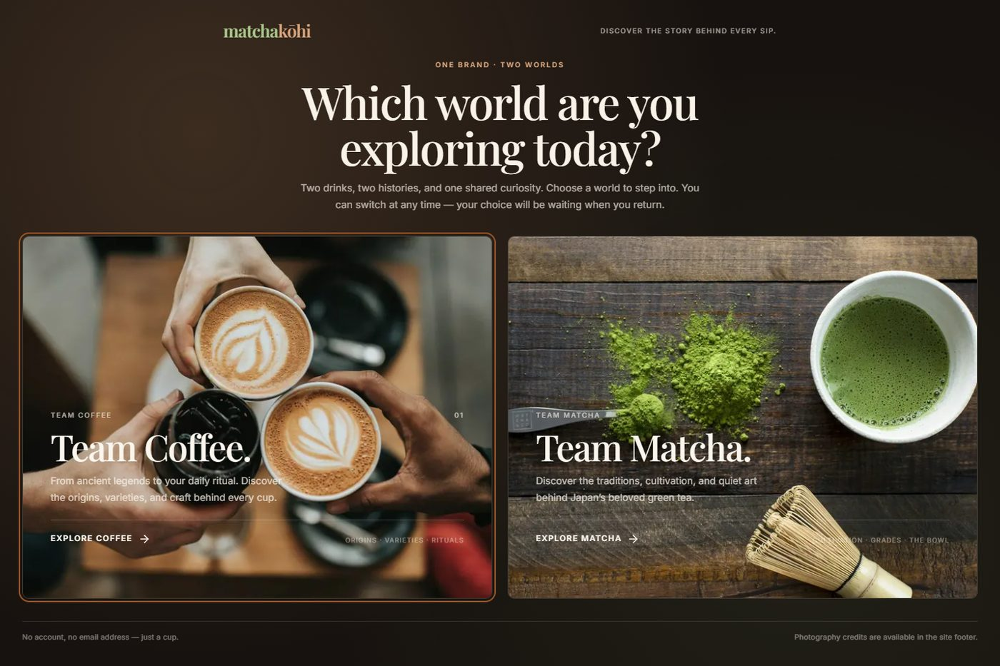
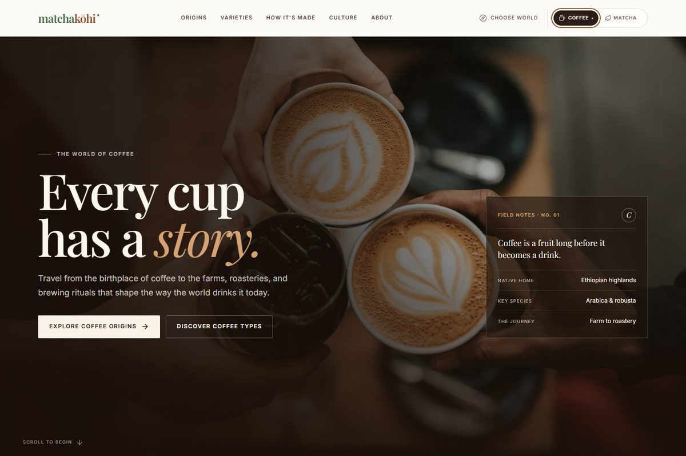
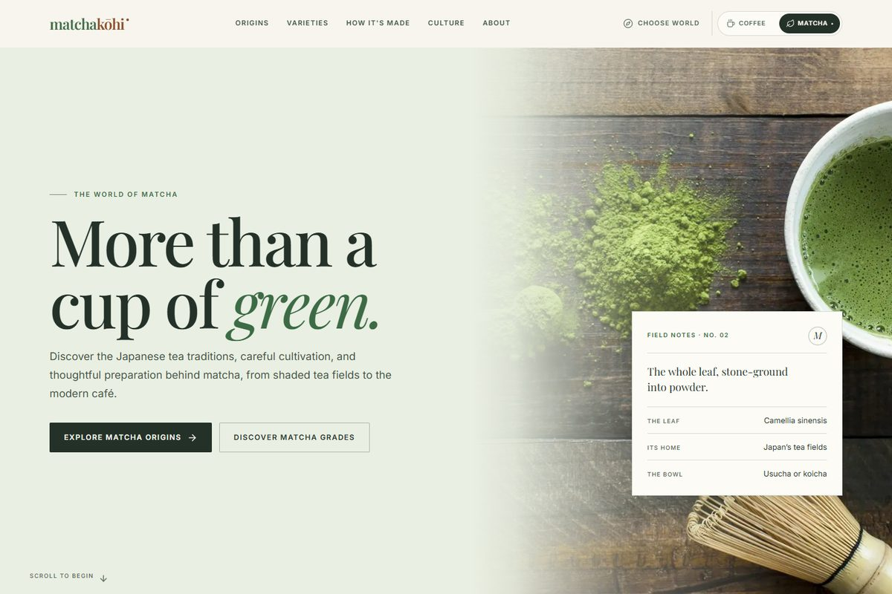

# Matchakohi

**Two worlds. One love for the perfect cup.** A premium, editorial digital magazine about coffee and matcha — their origins, cultivation, varieties, flavor, preparation, and cultures.

Live site: **https://www.matchakohi.store/**



| The coffee world | The matcha world |
| --- | --- |
|  |  |

---

## What is inside

Matchakohi is one React application with two complete experiences. The first visit opens a full-screen world selector:

- **Team Coffee** — Ethiopian and Yemeni roots, coffeehouse history, species and cultivars, processing, brewing methods, café drinks, and four guided brewing recipes.
- **Team Matcha** — tea's route from China to Japan, chanoyu, Uji and regional tea culture, grades, usucha and koicha, and four matcha preparations.

The navigation switcher changes the entire experience — palette, typography accents, hero, content, imagery, comparisons, quiz, and calls to action — without a page reload. The choice is saved in `localStorage`, while the public address bar stays clean at `https://www.matchakohi.store/`. Legacy `?theme=coffee` / `?theme=matcha` and `#section` links are still understood on arrival, then cleaned from the URL. A world selector can be reopened from the navigation, footer, or mobile menu.

### Sections in both worlds

1. Hero and editorial introduction
2. Origins and history (illustrated timeline)
3. From farm to cup / tea field to bowl (production process)
4. Types and varieties, with expandable detail
5. Interactive flavor-profile explorer
6. Step-by-step preparation guide (tabs, ingredient specs, checkable steps, progress, reset)
7. Culture and global traditions
8. Coffee vs matcha comparison (table on desktop, stacked cards on mobile)
9. Short interactive discovery quiz with a relevant next step
10. About Matchakohi
11. Final call to action
12. Sources, image credits, footer

### Interaction and accessibility

- Theme switcher uses a keyboard-operable radio group with visible active state.
- World selector is a focus-trapped dialog; the background is inert and scrolling is locked.
- Mobile menu supports Escape, focus movement, and outside-click dismissal.
- All primary CTAs are real anchors; smooth scrolling respects `prefers-reduced-motion`.
- Preparation steps use native checkboxes; guides also expose a progress bar and reset control.
- The flavor explorer and quiz use native buttons/radios, live regions, and reset controls.
- Image alt text, semantic headings, skip link, visible focus rings, and safe-area padding are included.
- Tested with axe-core (WCAG 2.0/2.1 A/AA): **0 violations** on desktop, mobile, and modal states.

## Stack

- React 19 + TypeScript
- Vite 8
- Hand-authored CSS with themed custom properties (no UI framework)
- Lucide icons
- No backend, analytics, accounts, or tracking

## Run locally

```bash
npm install
npm run dev
```

Production build and preview:

```bash
npm run build
npm run preview
```

Type checking:

```bash
npm run typecheck
```

## Browser QA script

The repository includes `scripts/visual-check.mjs`. It starts the production preview, drives Microsoft Edge with Playwright, exercises both themes and all interactive sections, checks for console errors, horizontal overflow at 320/375/768/1024/1440 px, missing images, persistence, and axe accessibility violations, and writes screenshots to `screens/`.

```bash
npm run qa
```

Requirements: a local Edge installation at the default Windows path, or set `BROWSER_PATH` to Chrome/Edge/Chromium.

After a Pages deployment, verify the live site, image assets, theme persistence, and accessibility with:

```bash
npm run check:live
```

## Structure

```text
public/
  images/             local responsive images (WebP + JPEG fallback)
  favicon.svg, robots.txt, sitemap.xml
src/
  data/
    types.ts          typed content model
    coffee.ts         complete coffee content configuration
    matcha.ts         complete matcha content configuration
    shared.ts         navigation, comparison, sources, credits, about copy
    index.ts          theme → content lookup
  theme/ThemeContext.tsx
  components/         Navbar, ThemeSwitcher, ThemeSelectionScreen, Hero,
                      OriginsTimeline, ProcessSection, VarietyExplorer,
                      FlavorExplorer, PreparationGuide, CultureSection,
                      Comparison, DiscoveryQuiz, AboutSection, FinalCTA,
                      SourcesCredits, Footer, BackToTop, and shared UI
  styles/             tokens, base, components, sections, responsive
  hooks/              active section + scroll state
  App.tsx, main.tsx
.github/workflows/deploy.yml
scripts/visual-check.mjs
```

## Content and sourcing

The educational copy was written for this project and deliberately separates established history from legend and debate (for example, the Kaldi story and the earliest coffee drinking in Yemen). Measurements are presented as starting points, not universal rules. Grade labels for matcha are described as commercial and non-standardized. Caffeine figures are broad, sourced ranges and are not medical advice.

Further reading links are included in the site’s **Sources & credits** section. They include the International Coffee Organization, World Coffee Research, the Specialty Coffee Association, Kew’s Plants of the World Online, ITO EN, Project Gutenberg’s *The Book of Tea*, EFSA, and USDA FoodData Central.

### Photography

- 17 photographs from **Unsplash**, used under the [Unsplash License](https://unsplash.com/license).
- 19 photographs from **Wikimedia Commons** under CC0, CC BY, CC BY-SA, public-domain, or no-known-restriction terms. Author, source, and licence are listed in the site’s Photography credits and in `src/data/shared.ts`.
- All images are resized and cropped for layout. No photographer or institution endorses this project.
- The code and original written content are MIT licensed; photographs remain under their respective licences.

## Deployment

The public site is served at **https://www.matchakohi.store/** (Vercel). The included GitHub Actions workflow still publishes a copy to GitHub Pages on every push to `main`; that copy redirects visitors to the custom domain. If GitHub Pages is no longer needed as a fallback, disable it in the repository settings and remove `.github/workflows/deploy.yml`.

`vite.config.ts` uses a relative `base: './'`, so the build is portable. Canonical, Open Graph, robots, and sitemap URLs point to `https://www.matchakohi.store/`. Update those files if the production domain changes.

The domain currently resolves on `www` only. Add the apex domain `matchakohi.store` in Vercel as a redirect to `https://www.matchakohi.store/` if visitors may type the bare domain.

## Limitations

This is an educational publication, not a shop or a health resource. There is no newsletter, account system, social media presence, or physical-store information because none was supplied. Historical dates that are debated are described as such; regional practices vary. No claim is made that one beverage is universally healthier or better.
